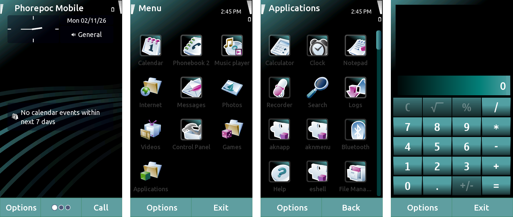

<p align="center">
  
</p>

<h1 align="center">Phorepoc OS for the PinePhone</h1>

<p align="center">
  <b>Phorepoc OS on the PINE64 PinePhone, straight from a microSD card.</b><br>
  The full interface with its own apps, graphics on the phone's GPU, Wi-Fi and sound. The phone's own system is never touched.
</p>

<p align="center">
  <a href="https://github.com/Phorepoc/adaptation-pinephone/releases/latest">Download</a> ·
  <a href="https://github.com/Phorepoc">Phorepoc</a> ·
  <a href="https://github.com/Phorepoc/adaptation-pc">PC and VirtualBox</a> ·
  <a href="https://github.com/Phorepoc/pdk">PDK and PhoneLab</a>
</p>

<p align="center">
  <a href="https://github.com/Phorepoc/adaptation-pinephone/releases/latest"></a>
  
  
  
</p>

---

[Phorepoc OS](https://github.com/Phorepoc) is an open-source mobile operating system with its roots in Symbian, built
from the source Nokia and the Symbian Foundation released in 2010. On the PinePhone it brings the Symbian^3 interface
and its apps to a phone with a modern chip, drawn by the phone's GPU.

## Try it

1. Download `phorepoc-pinephone-sdcard.img.xz` from the
   [latest release](https://github.com/Phorepoc/adaptation-pinephone/releases/latest).
2. Write it to a microSD card with [balenaEtcher](https://etcher.balena.io).
3. Put the card in and switch the phone on.

Phorepoc OS runs from the card. Take the card out and the phone boots its own system again.

These are development images for now. Besides Phorepoc OS, the card holds a small fallback system (the golden image): if a
newer image fails to boot, the phone falls back to it. To update a card, push the release's
`phorepoc-pinephone-update.img.xz` with the [pdk](https://github.com/Phorepoc/pdk), after unpacking it:

```sh
xz -d phorepoc-pinephone-update.img.xz
phe device push phorepoc-pinephone-update.img -w "Idle: ready"
```

## What works

- **The interface.** The home screen, the menu and the built-in apps, with their transition effects, composed on the
  GPU (OpenGL ES through [Mesa](https://github.com/Phorepoc/mesa-symbian)).
- **The touch screen** and the power key.
- **Wi-Fi**, with modern TLS, so apps and the web work over today's internet.
- **Sound** through the speaker.
- **The motion sensors**, through Symbian's own sensor framework.
- **Apps and games** made for Symbian^3, installed from SIS files.

Not yet: the camera, the volume keys, the headphone jack, and calls over the modem.

## Building

The [pdk](https://github.com/Phorepoc/pdk) has the commands, from the source to the card image. With this repository,
[adaptation-a64](https://github.com/Phorepoc/adaptation-a64) and [mesa-symbian](https://github.com/Phorepoc/mesa-symbian)
checked out next to core and the pdk, `-b pinephone` picks them up by itself.

Every push to `main` builds the image on GitHub Actions, from the exact commits `board.lock` pins. When the commits ask
for a release ([Conventional Commits](https://www.conventionalcommits.org): `feat`, `fix` or a breaking change), it is
released under the next version.

<details>
<summary>What's in this repository</summary>

| Folder | What it holds |
|---|---|
| `os/board/` | The phone's settings, plus the Bluetooth and Wi-Fi configuration and firmware |
| `os/src/` | The Bluetooth driver (`hctl_h5`, `initialisor_rtl`), Wi-Fi start-up, the phone's tests |
| `os/tools/phorepoc-arm/` | The scripts that make the card image |
| `recipes/` | The image and release recipes `phe` runs |
| `registry/` | The components this repository adds |

The drivers for the phone's chip, the Allwinner A64, are in [adaptation-a64](https://github.com/Phorepoc/adaptation-a64).
At build time `os/` is laid over core's `os/`, so the paths line up with core's.

</details>

## Licence

Code we wrote is Apache-2.0. Symbian files we've changed are EPL-2.0, with GPL-2.0-or-later as a Secondary License, and
Symbian files we use unchanged stay EPL-1.0. The licence texts are in `LICENSES/`.

The Realtek firmware in `os/board/bt/fw/` and `wlan/fw/` comes from linux-firmware, and can be redistributed under the
licence next to it.

Contributions are welcome under the same terms. Add your name to `AUTHORS` in your first pull request.

<sub>Phorepoc is an independent project, not affiliated with Nokia, the Symbian Foundation or PINE64.</sub>
